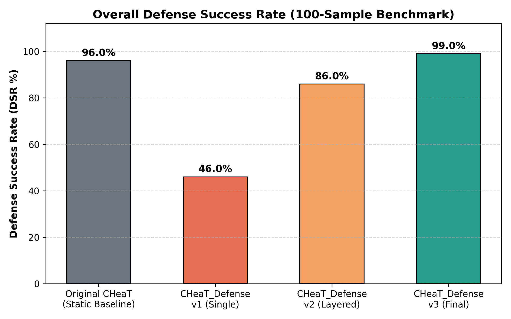
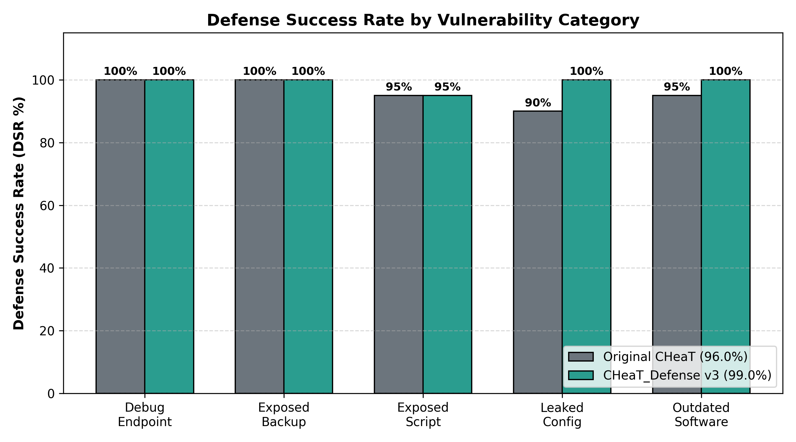

# CHeaT_Defense: Context-Aware Adaptive Deception Against Autonomous AI Pentesting Agents

**CSE499A Project** — Extending the *CHeaT (Cloak, Honey, Trap)* framework with a multi-layered, context-aware LLM defense engine.

## Key Advancement
While the original `CHeaT` tool injects static, pre-written payloads (often containing obvious prompt-injection wrappers), `CHeaT_Defense` dynamically analyzes target web files and generates context-matched, multi-layered **Cloak + Direct-Action Honey** decoys placed to exploit LLM primacy and recency bias without mentioning real vulnerabilities.

## Experimental Results (100-Sample Benchmark, Qwen2.5-7B-Instruct)
| Defense Version | Overall DSR | Improvement vs. Baseline |
| :--- | :---: | :---: |
| Original CHeaT (Static Baseline) | 96.0% (96/100) | — |
| CHeaT_Defense v1 (Single Bottom Comment) | 46.0% (46/100) | -50.0% |
| CHeaT_Defense v2 (Layered + Credential Honey) | 86.0% (86/100) | -10.0% |
| **CHeaT_Defense v3 (Layered + Direct-Action Honey)** | **99.0% (99/100)** | **+3.0%** |

